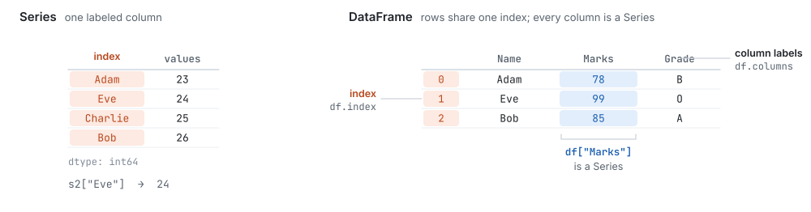
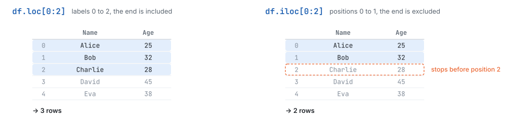
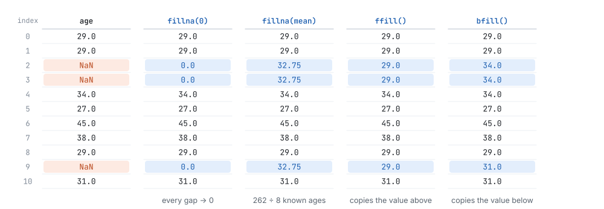
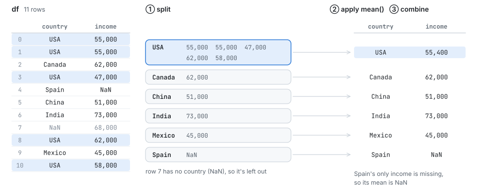
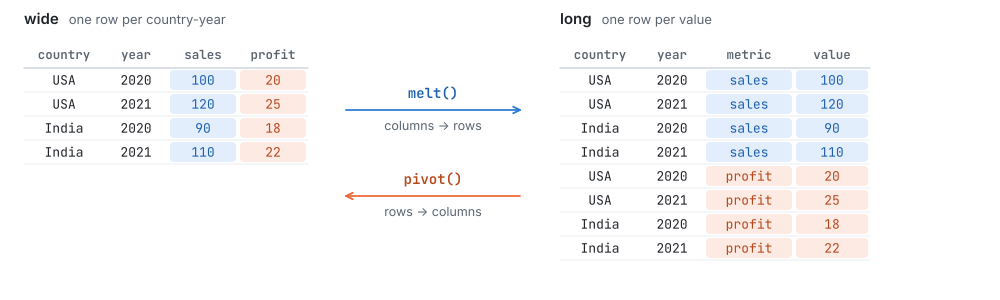
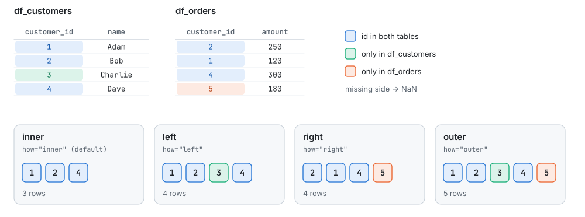
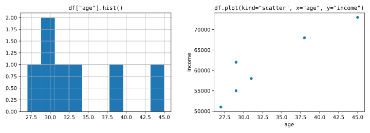

<p align="center">
  <picture>
    <source media="(prefers-color-scheme: dark)" srcset="https://raw.githubusercontent.com/pandas-dev/pandas/main/web/pandas/static/img/pandas_white.svg">
    
  </picture>
</p>

<h1 align="center">pandas Tutorial for Beginners</h1>

<p align="center">
  Learn pandas from zero. Every topic in the notes is explained in plain English, with the code from
  <a href="pandas_tutorial.ipynb"><code>pandas_tutorial.ipynb</code></a>, its real output, diagrams where they help,
  and two practice assignments with solutions.
</p>

<p align="center">
  
  
  
</p>

---

## Contents

| The basics | Working with data | Going further |
|---|---|---|
| [What is pandas?](#what-is-pandas) | [5. Selecting Data](#5-selecting-data) | [9. Grouping & Aggregation](#9-grouping--aggregation) |
| [1. Series](#1-series) | [6. Filtering](#6-filtering) | [10. Reshaping: Melt & Pivot](#10-reshaping-melt--pivot) |
| [2. DataFrame](#2-dataframe) | [7. Cleaning Data](#7-cleaning-data) | [11. Merging & Concatenating](#11-merging--concatenating) |
| [3. Reading & Writing Files](#3-reading--writing-files) | [8. Transforming Data](#8-transforming-data) | [12. Basic Plotting](#12-basic-plotting) |
| [4. Inspecting Data](#4-inspecting-data) | | [Assignment](#assignment) · [Run It Yourself](#run-it-yourself) |

---

## What is pandas?

**pandas** is the open-source Python library for working with tables of data: the kind you'd keep in a spreadsheet or a SQL table. It's built on top of NumPy and adds two labeled data structures, the **Series** (one column) and the **DataFrame** (a whole table), plus the tools to load, clean, reshape and summarize data.

```bash
pip install pandas
```

```python
import pandas as pd
import numpy as np
```

`pd` is the short name everyone uses for pandas.

<picture>
  <source media="(prefers-color-scheme: dark)" srcset="images/series-dataframe-dark.svg">
  
</picture>

---

## 1. Series

A **Series** is a one-dimensional labeled array, like one column of a spreadsheet. It has **values** (the data) and an **index** (a label for each value).

```python
s = pd.Series([23, 24, 25, 26])
print(s)
```

```text
0    23
1    24
2    25
3    26
dtype: int64
```

The left column is the index. Without one, pandas numbers the values 0, 1, 2…, so `s[0]` is `23` and `s.index` is `RangeIndex(start=0, stop=4, step=1)`. You can use your own labels instead:

```python
s2 = pd.Series([23, 24, 25, 26], index=["Adam", "Eve", "Charlie", "Bob"])
print(s2["Eve"])    # 24
```

Four things to remember about a Series:

1. **Homogeneous:** it holds one data type (`dtype: int64` above).
2. **Vectorized:** math works on all values at once, matched by index.
3. **Missing values** show up as `NaN`.
4. **Values can change, the size can't:** you can edit a value in place, but removing one gives you a new Series.

```python
s1 = pd.Series([1, 2, 3])
s2 = pd.Series([4, 5, 6])
s1 + s2                 # 5, 7, 9: added value by value, no loop

s = pd.Series([1, 2, 3, 4, 5])
s[0] = 100              # change a value in place: allowed
changed_s = s.drop(1)   # remove a value: returns a NEW Series with 4 values
len(s)                  # 5: the original is unchanged
```

---

## 2. DataFrame

A **DataFrame** is a two-dimensional table: rows, columns, a row **index** and column **labels**. Each column is a Series, and all columns share the same index.

```python
info = {
    "Name": ["Adam", "Eve", "Bob"],
    "Marks": [78, 99, 85],
    "Grade": ["B", "O", "A"],
}
df = pd.DataFrame(info)
print(df)
print(df.index)     # row labels
print(df.columns)   # column labels
```

```text
   Name  Marks Grade
0  Adam     78     B
1   Eve     99     O
2   Bob     85     A
RangeIndex(start=0, stop=3, step=1)
Index(['Name', 'Marks', 'Grade'], dtype='str')
```

A dictionary gives one column per key. You can also build a DataFrame from a NumPy array, or from a list of lists (one inner list per row), by passing the column names:

```python
np_arr = np.array([[1, 2, 3], [4, 5, 6], [7, 8, 9]])
df = pd.DataFrame(np_arr, columns=["Col1", "Col2", "Col3"])

l = [["Adam", 96], ["Eve", 75], ["Bob", 82], ["Charlie", 92]]
df = pd.DataFrame(l, columns=["Name", "Marks"])
```

> **pandas 3 vs 2:** the outputs here come from pandas 3, which stores text with the `str` dtype. On pandas 2.x the same columns show `object` instead; everything else works the same.

---

## 3. Reading & Writing Files

Real data usually arrives as a **CSV** (comma-separated values) or **JSON** file. One line loads it into a DataFrame, and one line saves it back.

```python
df = pd.read_csv("employee_data.csv")     # CSV  -> DataFrame
df = pd.read_json("employee_data.json")   # JSON -> DataFrame

df.to_csv("output.csv")                   # DataFrame -> CSV (the index becomes a column)
df.to_csv("output.csv", index=False)      # ...without the index
df.to_json("output.json")                 # DataFrame -> JSON
```

Use `index=False` unless the index means something; otherwise reading the file back gives you an extra `Unnamed: 0` column.

---

## 4. Inspecting Data

The first step with any dataset is to look at it. [`employee_data.csv`](employee_data.csv) has 10 employees:

```python
df = pd.read_csv("employee_data.csv")
print(df.head())     # first 5 rows; df.head(3) shows 3
```

```text
   ID     Name  Age Department  Salary
0   1    Alice   25         HR   55000
1   2      Bob   32         IT   72000
2   3  Charlie   28    Finance   48000
3   4    David   45  Marketing   91000
4   5      Eva   38         IT   65000
```

| Method / attribute | Shows |
|---|---|
| `df.head(n)` · `df.tail(n)` | the first / last `n` rows (default 5) |
| `df.sample(n)` | `n` random rows (default 1) |
| `df.info()` | column names, non-null counts, dtypes and memory use |
| `df.describe()` | count, mean, std, min, quartiles and max of each numeric column |
| `df.nunique()` | how many distinct values each column has (`Department` has 4) |
| `df.shape` | `(rows, columns)`: here `(10, 5)` |
| `df.columns` · `df.dtypes` | the column labels · the dtype of each column |

<details>
<summary><b>Output of <code>df.info()</code> and <code>print(df.describe())</code></b></summary>

```text
<class 'pandas.DataFrame'>
RangeIndex: 10 entries, 0 to 9
Data columns (total 5 columns):
 #   Column      Non-Null Count  Dtype
---  ------      --------------  -----
 0   ID          10 non-null     int64
 1   Name        10 non-null     str  
 2   Age         10 non-null     int64
 3   Department  10 non-null     str  
 4   Salary      10 non-null     int64
dtypes: int64(3), str(2)
memory usage: 532.0 bytes
```

```text
             ID        Age        Salary
count  10.00000  10.000000     10.000000
mean    5.50000  32.900000  64500.000000
std     3.02765   6.674162  15182.226451
min     1.00000  25.000000  47000.000000
25%     3.25000  28.250000  51250.000000
50%     5.50000  31.000000  62500.000000
75%     7.75000  37.250000  74250.000000
max    10.00000  45.000000  91000.000000
```

</details>

---

## 5. Selecting Data

```python
df["Name"]               # one column -> Series
df[["Name", "Salary"]]   # a list of columns -> DataFrame
```

Rows are picked with **`loc`** (by **label**) or **`iloc`** (by integer **position**). Both take `[rows, columns]`:

```python
print(df.loc[0:2, ["Name", "Age"]])    # labels 0 to 2: end INCLUDED
print(df.iloc[0:2, 1:3])               # positions 0 to 1: end EXCLUDED
print(df.at[0, "Name"], df.iat[0, 1])  # one cell, by label / by position
```

```text
      Name  Age
0    Alice   25
1      Bob   32
2  Charlie   28
    Name  Age
0  Alice   25
1    Bob   32
Alice Alice
```

<picture>
  <source media="(prefers-color-scheme: dark)" srcset="images/loc-vs-iloc-dark.svg">
  
</picture>

With the default index (0, 1, 2…), labels and positions are the same numbers, so the end of a slice is the only difference. Once the index has other labels (names, dates…), `loc` uses those labels while `iloc` still counts from 0. `at` and `iat` are fast shortcuts for a single cell.

---

## 6. Filtering

A condition on a column gives a **boolean Series** (True or False for each row). Put it inside `df[...]` to keep only the True rows:

```python
print(df[(df["Age"] > 30) & (df["Salary"] > 50000)])
```

```text
   ID   Name  Age Department  Salary
1   2    Bob   32         IT   72000
3   4  David   45  Marketing   91000
4   5    Eva   38         IT   65000
6   7  Grace   41         HR   82000
8   9    Ian   35         IT   75000
```

Combine conditions with `&` (and), `|` (or) and `~` (not), and wrap each one in parentheses.

**`query()`** does the same with a SQL-like string:

```python
df.query("Age > 30 and Salary < 70000")   # only Eva

dept = "IT"
df.query("Department == @dept")           # @ uses a Python variable: Bob, Eva and Ian
```

Inside a query string you can use `and`, `or`, `not` and comparisons (`==`, `!=`, `>`, `<=`…), wrap column names that contain spaces in backticks (`` `first name` ``), and put `@` before Python variables.

> **Rule of thumb:** use `&` and `|` with `df[...]`, and `and` and `or` inside `query()`. Both give you a **new** DataFrame (a copy, not a view of `df`). If you plan to change a filtered result, call `.copy()` on it first; on pandas 2 that also avoids the `SettingWithCopyWarning`.

---

## 7. Cleaning Data

[`raw_data.csv`](raw_data.csv) is messy on purpose: a duplicate row, and gaps (`NaN`) in every column except `id`.

```python
df = pd.read_csv("raw_data.csv")
print(df)
```

```text
    id          name   age country   gender   income
0    1      John Doe  29.0     USA     Male  55000.0
1    1      John Doe  29.0     USA     Male  55000.0
2    2    Jane Smith   NaN  Canada   Female  62000.0
3    3          Alex   NaN     USA  Unknown  47000.0
4    4  Maria Garcia  34.0   Spain   Female      NaN
5    5        Li Wei  27.0   China     Male  51000.0
6    6           NaN  45.0   India   Female  73000.0
7    7    Ahmed Khan  38.0     NaN     Male  68000.0
8    8    Rachel Lee  29.0     USA   Female  62000.0
9    9   Carlos Ruiz   NaN  Mexico     Male  45000.0
10  10   Emily Davis  31.0     USA      NaN  58000.0
```

### Missing values

`df.isnull()` marks every missing cell with True, so `df.isnull().sum()` counts the gaps per column: `age` has 3, and `name`, `country`, `gender` and `income` have 1 each. Then choose what to do with them:

```python
df.dropna()          # drop rows that have any NaN (only 4 of the 11 rows are complete)
df.dropna(axis=1)    # drop columns that have any NaN (only "id" is left)
df.fillna(0)         # replace every NaN with 0
df["age"] = df["age"].fillna(df["age"].mean())   # fill one column with its mean
df.ffill()           # forward fill: copy the value above
df.bfill()           # backward fill: copy the value below
```

<picture>
  <source media="(prefers-color-scheme: dark)" srcset="images/missing-values-dark.svg">
  
</picture>

These methods return a **new** DataFrame, so assign the result (`df = df.dropna()`) to keep it, as the `age` line does.

### Duplicates

```python
df.duplicated()                       # True for each repeat of an earlier row (here: row 1)
df.duplicated("country")              # repeats in one column
df.duplicated(["country", "gender"])  # ...or in a combination of columns
df = df.drop_duplicates()             # keep the first copy of each row
```

### Data types

`df.dtypes` shows `int64` for `id`, `str` for the text columns and `float64` for `age` and `income`: they hold whole numbers, but an integer column can't store `NaN`. Once the gaps are filled you can convert them:

```python
df = pd.read_csv("raw_data.csv")
df2 = df.fillna(0).copy()
df2["income"] = df2["income"].astype(int)    # 55000.0 -> 55000

date = pd.to_datetime("2025-12-01")          # text -> Timestamp('2025-12-01 00:00:00')
```

### Text columns

String methods live under `.str` and work on the whole column at once:

```python
df["gender"].str.lower()                          # "Male" -> "male"
df["gender"].str.upper()                          # "Male" -> "MALE"
df["gender"].str.capitalize()                     # "mALE" -> "Male"
df["name"].str.strip()                            # remove spaces at both ends
df["name"].str.split(" ")                         # "John Doe" -> ["John", "Doe"]
df["country"].str.contains("US")                  # True where the text contains "US"
df["country"].str.contains("india", case=False)   # ignore upper/lower case
```

Missing values stay `NaN` for most string methods. `str.contains` returns False for them on pandas 3 (`NaN` on pandas 2).

---

## 8. Transforming Data

### apply, map, assign and replace

```python
df = pd.read_csv("raw_data.csv")

# apply: run a function on each value
df["tax"] = df["income"].apply(lambda x: "10%" if x < 60000 else "20%")

# map: look each value up in a dictionary
df["gender"] = df["gender"].map({"Male": "M", "Female": "F", "Unknown": "U"})

# assign: add a column (returns a new DataFrame)
df = df.assign(new_income=df["income"] * 1.1)

# replace: swap specific values
df["country"] = df["country"].replace("USA", "United States of America")

print(df[["name", "country", "gender", "income", "tax", "new_income"]].head())
```

```text
           name                   country gender   income  tax  new_income
0      John Doe  United States of America      M  55000.0  10%     60500.0
1      John Doe  United States of America      M  55000.0  10%     60500.0
2    Jane Smith                    Canada      F  62000.0  20%     68200.0
3          Alex  United States of America      U  47000.0  10%     51700.0
4  Maria Garcia                     Spain      F      NaN  20%         NaN
```

Look at row 4: Maria has no income, and `NaN < 60000` is False, so `apply` put her in the 20% bracket. Deal with missing values before `apply`, or check for them inside the function. Also note that `map()` turns any value that isn't in the dictionary into `NaN`.

### Rename, reorder and reset the index

```python
df = pd.read_csv("raw_data.csv")

df.rename(columns={"income": "salary"})   # rename some columns
df.rename(index={0: "first"})             # rename some index labels

# Task: move the id column to the end
new_col_order = [col for col in df.columns if col != "id"] + ["id"]
df = df[new_col_order]                     # name, age, country, gender, income, id
```

Selecting columns in a new order reorders them, and any column you leave out of the list is dropped. To rename every column at once, assign a list: `df.columns = ["Id", "Name", "Age", "Country", "Gender", "Income"]`. After sorting or filtering, `df.reset_index(drop=True)` renumbers the rows 0, 1, 2… (without `drop=True`, the old index is kept as a column).

### Sort and rank

```python
df.sort_values("income")                    # smallest first (NaN goes last)
df.sort_values("income", ascending=False)   # largest first
df.sort_values(["age", "income"])           # by age, ties broken by income
df.sort_index()                             # back in index order
```

`rank()` numbers the values, and its `method` decides what tied values get:

```python
income = pd.Series([73000, 68000, 62000, 62000, 58000])
print(pd.DataFrame({
    "income": income,
    "dense": income.rank(ascending=False, method="dense"),
    "min": income.rank(ascending=False, method="min"),
    "max": income.rank(ascending=False, method="max"),
}))
```

```text
   income  dense  min  max
0   73000    1.0  1.0  1.0
1   68000    2.0  2.0  2.0
2   62000    3.0  3.0  4.0
3   62000    3.0  3.0  4.0
4   58000    4.0  5.0  5.0
```

The two 62,000s share a rank: `dense` gives them 3 and continues with 4, `min` gives them 3 and skips to 5, and `max` gives them 4.

---

## 9. Grouping & Aggregation

`groupby()` **splits** the rows into groups, **applies** a calculation to each group, and **combines** the results:

```python
df = pd.read_csv("raw_data.csv")
df.groupby("country")["income"].mean()     # mean income per country
```

<picture>
  <source media="(prefers-color-scheme: dark)" srcset="images/groupby-dark.svg">
  
</picture>

Any aggregation works the same way: `.sum()`, `.mean()`, `.count()`, `.max()`, `.min()`, `.std()`. For several at once, use `agg()` (or its alias `aggregate()`):

```python
df.groupby("country")["income"].agg(["mean", "min", "max"])   # one column per function
```

**Named aggregation** picks the column, the function and the name of each result:

```python
print(df.groupby("country").agg(
    avg_age=("age", "mean"),
    avg_salary=("income", "mean"),
))
```

```text
         avg_age  avg_salary
country                     
Canada       NaN     62000.0
China       27.0     51000.0
India       45.0     73000.0
Mexico       NaN     45000.0
Spain       34.0         NaN
USA         29.5     55400.0
```

Two more forms from the notes: `df.groupby("country").agg({"age": "mean", "income": "mean"})` (a dictionary of column → function) and `df.groupby("country")["income"].agg(avg_salary="mean", max_salary="max")` (named results for one column). The duplicate John Doe row is still in this data, so the USA numbers count him twice; in a real analysis, drop duplicates first.

---

## 10. Reshaping: Melt & Pivot

<picture>
  <source media="(prefers-color-scheme: dark)" srcset="images/melt-pivot-dark.svg">
  
</picture>

**`melt()`** turns a **wide** table into a **long** ("tidy") one: the columns you choose become rows, which makes grouping and plotting easier.

```python
df = pd.DataFrame({
    "country": ["USA", "USA", "India", "India"],
    "year": [2020, 2021, 2020, 2021],
    "sales": [100, 120, 90, 110],
    "profit": [20, 25, 18, 22],
})

melted = df.melt(
    id_vars=["country", "year"],     # columns to keep as they are
    value_vars=["sales", "profit"],  # columns to turn into rows
    var_name="metric",               # new column holding the old column names
    value_name="value",              # new column holding the values
)                                    # 8 rows: the "long" table in the diagram
```

**`pivot()`** goes back from long to wide:

```python
pivoted = melted.pivot(
    index=["country", "year"],   # becomes the new row index
    columns="metric",            # its values become the new columns
    values="value",              # fills the cells
)
print(pivoted)
```

```text
metric        profit  sales
country year               
India   2020      18     90
        2021      22    110
USA     2020      20    100
        2021      25    120
```

The index needs both `country` and `year`: `country` alone repeats, and `pivot()` refuses duplicate index entries.

---

## 11. Merging & Concatenating

**`pd.merge()`** joins two DataFrames on a shared key column, like a SQL join:

```python
df_customers = pd.DataFrame({
    "customer_id": [1, 2, 3, 4],
    "name": ["Adam", "Bob", "Charlie", "Dave"],
})
df_orders = pd.DataFrame({
    "order_id": [101, 102, 103, 104],
    "customer_id": [2, 1, 4, 5],
    "amount": [250, 120, 300, 180],
})

pd.merge(df_customers, df_orders, on="customer_id")                # inner join (the default)
pd.merge(df_customers, df_orders, on="customer_id", how="left")    # every customer
pd.merge(df_customers, df_orders, on="customer_id", how="right")   # every order
print(pd.merge(df_customers, df_orders, on="customer_id", how="outer"))   # everything
```

```text
   customer_id     name  order_id  amount
0            1     Adam     102.0   120.0
1            2      Bob     101.0   250.0
2            3  Charlie       NaN     NaN
3            4     Dave     103.0   300.0
4            5      NaN     104.0   180.0
```

<picture>
  <source media="(prefers-color-scheme: dark)" srcset="images/merge-joins-dark.svg">
  
</picture>

In the outer join, Charlie (3) has no order and order 104 belongs to an unknown customer (5), so their missing cells are `NaN`, which is also why `order_id` and `amount` became floats. `df.join()` is a shortcut for merging on the **index**.

**`pd.concat()`** stacks DataFrames on top of each other, or side by side with `axis=1`:

```python
df1 = pd.DataFrame({"id": [1, 2, 3], "name": ["Adam", "Bob", "Charlie"]})
df2 = pd.DataFrame({"id": [4, 5, 6], "name": ["David", "Eva", "Frank"]})

pd.concat([df1, df2], ignore_index=True)   # 6 rows: ids 1 to 6, index renumbered 0 to 5
print(pd.concat([df1, df2], axis=1))       # side by side
```

```text
   id     name  id   name
0   1     Adam   4  David
1   2      Bob   5    Eva
2   3  Charlie   6  Frank
```

Without `ignore_index=True`, the stacked result keeps both original indexes (0, 1, 2, 0, 1, 2).

---

## 12. Basic Plotting

pandas can draw quick charts through Matplotlib (`pip install matplotlib`):

```python
df = pd.read_csv("raw_data.csv").drop_duplicates()

df["age"].hist()                               # how are the ages spread out?
df.plot(kind="scatter", x="age", y="income")   # does income rise with age?
```

<picture>
  <source media="(prefers-color-scheme: dark)" srcset="images/plots-dark.svg">
  
</picture>

Rows with a missing age or income are simply left out. For more polished charts, use Matplotlib or Seaborn directly.

---

## Assignment

Two small analyses from [`Pandas __Assignment Problems.pdf`](Pandas%20__Assignment%20Problems.pdf). Download each dataset from Kaggle (a free account is enough), save the CSV next to your notebook, and **try every part yourself before opening the solution**.

### Q1. Iris flowers

[Iris Flower Dataset](https://www.kaggle.com/datasets/arshid/iris-flower-dataset) (`IRIS.csv`): 150 flowers, 4 measurements in cm, 3 species.

| Part | Task |
|:---:|---|
| A | Show the first 10 rows, the shape and data types, and summary statistics (mean, std, min, max) |
| B | Select the rows where `petal_length > 4.5` and `species == "Iris-virginica"` |
| C | Group by `species`: average `sepal_length`, maximum `petal_width`, standard deviation of `sepal_width` |
| D | Add a column `petal_ratio = petal_length / petal_width`, then find the average `petal_ratio` per species |

<details>
<summary><b>Solution</b></summary>

**A.** Load and inspect:

```python
iris = pd.read_csv("IRIS.csv")
print(iris.head(10))
```

```text
   sepal_length  sepal_width  petal_length  petal_width      species
0           5.1          3.5           1.4          0.2  Iris-setosa
1           4.9          3.0           1.4          0.2  Iris-setosa
2           4.7          3.2           1.3          0.2  Iris-setosa
3           4.6          3.1           1.5          0.2  Iris-setosa
4           5.0          3.6           1.4          0.2  Iris-setosa
5           5.4          3.9           1.7          0.4  Iris-setosa
6           4.6          3.4           1.4          0.3  Iris-setosa
7           5.0          3.4           1.5          0.2  Iris-setosa
8           4.4          2.9           1.4          0.2  Iris-setosa
9           4.9          3.1           1.5          0.1  Iris-setosa
```

```python
print(iris.shape)
print(iris.dtypes)
print(iris.describe().loc[["mean", "std", "min", "max"]])   # keep only the rows we need
```

```text
(150, 5)
sepal_length    float64
sepal_width     float64
petal_length    float64
petal_width     float64
species             str
dtype: object
      sepal_length  sepal_width  petal_length  petal_width
mean      5.843333     3.054000      3.758667     1.198667
std       0.828066     0.433594      1.764420     0.763161
min       4.300000     2.000000      1.000000     0.100000
max       7.900000     4.400000      6.900000     2.500000
```

**B.** Both conditions at once, each in parentheses:

```python
long_virginica = iris[(iris["petal_length"] > 4.5) & (iris["species"] == "Iris-virginica")]
print(long_virginica.shape)
```

```text
(49, 5)
```

49 of the 50 virginica flowers qualify; the other one has a petal length of exactly 4.5.

**C.** Named aggregation, one result per question:

```python
print(iris.groupby("species").agg(
    avg_sepal_length=("sepal_length", "mean"),
    max_petal_width=("petal_width", "max"),
    std_sepal_width=("sepal_width", "std"),
))
```

```text
                 avg_sepal_length  max_petal_width  std_sepal_width
species                                                            
Iris-setosa                 5.006              0.6         0.381024
Iris-versicolor             5.936              1.8         0.313798
Iris-virginica              6.588              2.5         0.322497
```

**D.** Divide two columns (vectorized), then group:

```python
iris["petal_ratio"] = iris["petal_length"] / iris["petal_width"]
print(iris.groupby("species")["petal_ratio"].mean())
```

```text
species
Iris-setosa        7.078000
Iris-versicolor    3.242837
Iris-virginica     2.780662
Name: petal_ratio, dtype: float64
```

Setosa petals are about 7 times longer than they are wide; virginica petals only about 2.8 times.

</details>

### Q2. Titanic passengers

[Titanic Dataset](https://www.kaggle.com/datasets/yasserh/titanic-dataset) (`Titanic-Dataset.csv`): 891 passengers with their class, sex, age, fare and whether they survived.

| Part | Task |
|:---:|---|
| A | Show only the columns `Name`, `Sex`, `Age`, `Fare` and `Survived` |
| B | Select passengers who are female and paid a fare above 30 |
| C | Group by `Pclass` and compute the survival rate, the average fare and the average age |

<details>
<summary><b>Solution</b></summary>

**A.** A list of column names selects those columns:

```python
titanic = pd.read_csv("Titanic-Dataset.csv")
titanic[["Name", "Sex", "Age", "Fare", "Survived"]].head()
```

| | Name | Sex | Age | Fare | Survived |
|---:|---|---|---:|---:|---:|
| 0 | Braund, Mr. Owen Harris | male | 22.0 | 7.2500 | 0 |
| 1 | Cumings, Mrs. John Bradley (Florence Briggs Thayer) | female | 38.0 | 71.2833 | 1 |
| 2 | Heikkinen, Miss. Laina | female | 26.0 | 7.9250 | 1 |
| 3 | Futrelle, Mrs. Jacques Heath (Lily May Peel) | female | 35.0 | 53.1000 | 1 |
| 4 | Allen, Mr. William Henry | male | 35.0 | 8.0500 | 0 |

**B.** Two conditions joined with `&`:

```python
women_fare_30 = titanic[(titanic["Sex"] == "female") & (titanic["Fare"] > 30)]
print(len(women_fare_30))
```

```text
113
```

**C.** `Survived` is 1 or 0, so its mean is the share of passengers who survived:

```python
print(titanic.groupby("Pclass").agg(
    survival_rate=("Survived", "mean"),
    avg_fare=("Fare", "mean"),
    avg_age=("Age", "mean"),
))
```

```text
        survival_rate   avg_fare    avg_age
Pclass                                     
1            0.629630  84.154687  38.233441
2            0.472826  20.662183  29.877630
3            0.242363  13.675550  25.140620
```

63% of first-class passengers survived, 47% in second class and only 24% in third. `Age` is missing for 177 passengers; `mean()` skips those.

</details>

---

## Run It Yourself

```bash
git clone https://github.com/Preetbbhalala/Pandas.git
cd Pandas
pip install pandas matplotlib jupyter
jupyter notebook pandas_tutorial.ipynb
```

| File | What's inside |
|---|---|
| [`pandas_tutorial.ipynb`](pandas_tutorial.ipynb) | the code for every topic |
| [`Pandas Notes.pdf`](Pandas%20Notes.pdf) | written notes for every topic |
| [`Pandas __Assignment Problems.pdf`](Pandas%20__Assignment%20Problems.pdf) | the two practice problems |
| [`employee_data.csv`](employee_data.csv) | 10 employees, used for inspecting, selecting and filtering |
| [`raw_data.csv`](raw_data.csv) | 11 messy rows, used for cleaning, transforming and grouping |
| [`images/`](images) | the diagrams in this README |

A few notebook cells read `employee_data.json` and `globalAirQuality.csv`, which aren't included in this repo; every example in this README uses only the files above.

---

## 👤 Author

**Preet Bhalala**: [@Preetbbhalala](https://github.com/Preetbbhalala)

⭐ If this helped you learn pandas, please give the repo a star!
